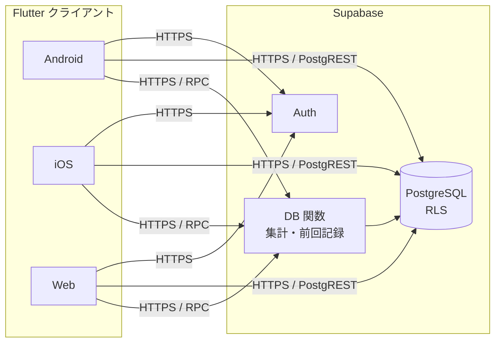
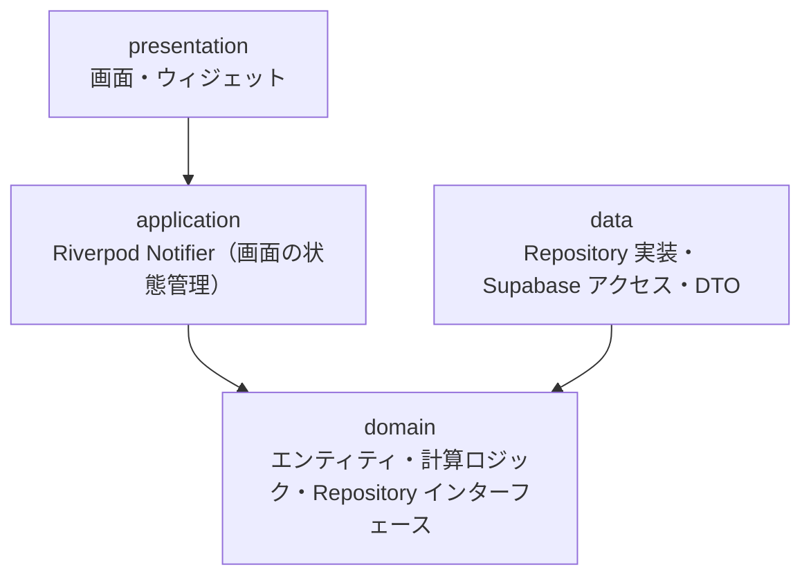
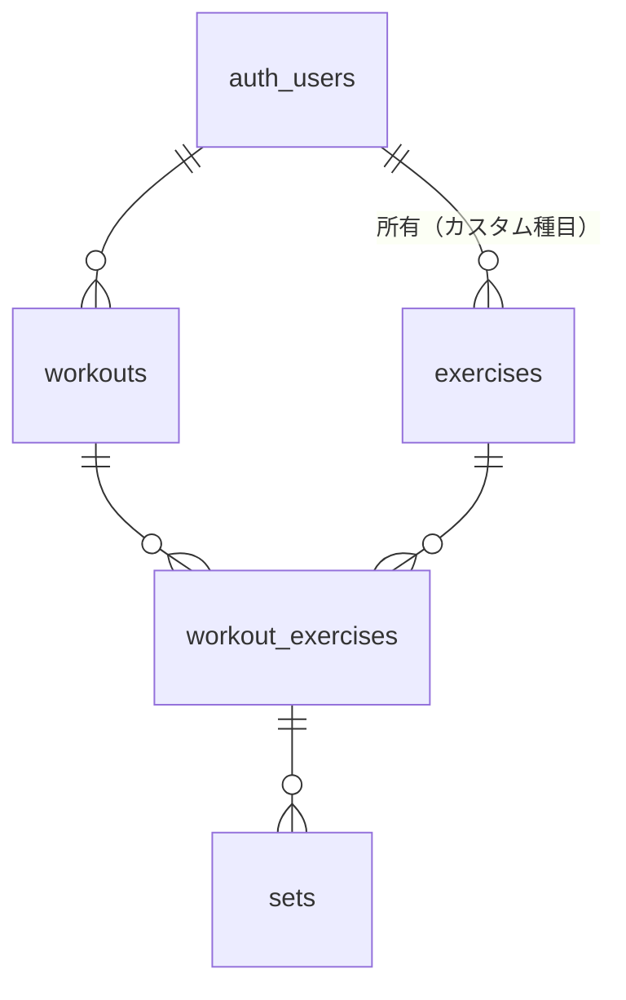
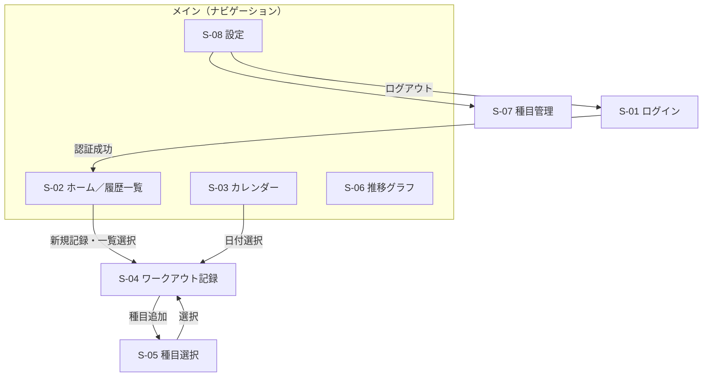

# 基本設計書 — LiftLog

| 項目 | 内容 |
|---|---|
| 文書バージョン | 0.2（ドラフト） |
| 作成日 | 2026-10-28 |
| 前提文書 | 01_要件定義書.md（v0.2） |

---

## 1. 本書の目的

要件定義書で定めた MVP 機能を実現するためのシステム構成、アーキテクチャ、データベース、画面遷移、テスト方針を定義する。クラス・メソッド単位の仕様は詳細設計書で定義する。

## 2. システム構成



- クライアントは Supabase の公式 Flutter SDK を通して Auth・DB・RPC にアクセスする
- 独自のアプリケーションサーバーは持たない。業務ルールのうちデータ整合性に関わるものは DB の制約・RLS・関数で担保する
- Web 版は静的ホスティング（Firebase Hosting / Cloudflare Pages 等）にデプロイする

## 3. 技術スタック

| 区分 | 採用技術 | 選定理由 |
|---|---|---|
| フレームワーク | Flutter（最新安定版）／Dart | 単一コードベースで Android・iOS・Web に対応 |
| 状態管理・DI | Riverpod（コード生成なし） | 依存関係の差し替えが容易でテストしやすい。ビルド手順を増やさないため、まずはコード生成を使わない（D-04） |
| ルーティング | go_router | Web の URL とディープリンクに対応 |
| バックエンド | supabase_flutter | Auth・DB・RPC を一括で利用 |
| イミュータブルモデル | 手書きの不変クラス（必要になれば freezed を導入） | エンティティ数が少ないうちはコード生成なしで十分（D-04） |
| グラフ | fl_chart | 3 プラットフォームで動作し、折れ線グラフのカスタマイズ性が高い |
| カレンダー | table_calendar | 実施日マーク表示に対応 |
| 多言語化 | flutter_localizations ／ ARB | 文言のリソース化（要件：多言語化への備え） |
| テスト | flutter_test ／ mocktail ／ integration_test | 単体・ウィジェット・結合テスト |
| 静的解析 | flutter_lints（＋独自ルール） | コード品質の統一 |

## 4. アーキテクチャ

### 4.1 レイヤー構成

機能単位（feature-first）でディレクトリを分け、各機能の中を 4 レイヤーに分離する。



| レイヤー | 責務 | 依存してよい先 |
|---|---|---|
| presentation | 画面表示、ユーザー操作の受付、レスポンシブ切り替え | application, domain |
| application | 画面単位の状態（`AsyncValue`）の保持、ユースケースの実行 | domain |
| domain | エンティティ、純粋な計算ロジック（推定 1RM 等）、Repository の抽象定義 | なし（Flutter・Supabase に依存しない） |
| data | Repository の実装、Supabase との通信、DTO ⇔ エンティティ変換 | domain |

- domain は外部ライブラリに依存しない純粋な Dart とし、単体テストを容易にする
- Repository の実装は Riverpod の Provider 経由で注入し、テスト時はフェイク実装に差し替える

### 4.2 ディレクトリ構成

```
lib/
├── main.dart
├── app/
│   ├── app.dart                 # MaterialApp.router
│   ├── router.dart              # go_router 定義・認証ガード
│   ├── theme.dart
│   └── env.dart                 # 環境変数（--dart-define）
├── core/
│   ├── error/                   # AppException・エラー変換
│   ├── layout/                  # ブレークポイント・レスポンシブ用ウィジェット
│   ├── supabase/                # SupabaseClient の Provider
│   └── widgets/                 # 共通ウィジェット
├── features/
│   ├── auth/
│   │   ├── data/  domain/  application/  presentation/
│   ├── exercise/                # 種目管理（F-02）
│   ├── workout/                 # 記録・前回記録・履歴（F-03〜F-05）
│   ├── progress/                # 推移グラフ（F-06）
│   └── settings/                # 設定（S-08）
└── l10n/
    └── app_ja.arb

test/                            # 単体・ウィジェットテスト（lib と同じ構成）
integration_test/                # 結合テスト
supabase/
├── migrations/                  # テーブル・RLS・関数の DDL
├── tests/database/              # pgTAP による DB テスト（RLS・集計関数）
└── seed.sql                     # プリセット種目
```

### 4.3 環境設定

- Supabase の URL と anon key は `--dart-define-from-file=env/dev.json` で注入し、リポジトリには含めない
- 環境は `dev`（ローカル Supabase、Supabase CLI で起動）と `prod`（Supabase クラウド）の 2 つとする

## 5. データベース設計

### 5.1 ER 図



### 5.2 テーブル定義

すべてのテーブルに `created_at`・`updated_at`（timestamptz、デフォルト `now()`、更新時はトリガーで更新）を持たせる。以下では省略する。

**exercises（種目）**

| カラム | 型 | 制約 | 説明 |
|---|---|---|---|
| id | uuid | PK, default `gen_random_uuid()` | |
| user_id | uuid | FK → auth.users, NULL 可, ON DELETE CASCADE | NULL の場合はプリセット種目 |
| name | text | NOT NULL, 1〜50 文字 | 種目名 |
| category | text | NOT NULL, CHECK（chest / back / legs / shoulders / arms / core / other） | 部位カテゴリ |

- 一意制約：`(user_id, name)`（同一ユーザー内で同名の種目を禁止）
- プリセット種目は `seed.sql` で投入する（要件定義書 14 章）

**workouts（ワークアウト）**

| カラム | 型 | 制約 | 説明 |
|---|---|---|---|
| id | uuid | PK | |
| user_id | uuid | FK → auth.users, NOT NULL, default `auth.uid()`, ON DELETE CASCADE | |
| performed_on | date | NOT NULL | 実施日 |
| memo | text | NULL 可, 500 文字以内 | |

- インデックス：`(user_id, performed_on DESC)`

**workout_exercises（ワークアウト種目）**

| カラム | 型 | 制約 | 説明 |
|---|---|---|---|
| id | uuid | PK | |
| workout_id | uuid | FK → workouts, NOT NULL, ON DELETE CASCADE | |
| exercise_id | uuid | FK → exercises, NOT NULL, ON DELETE CASCADE | 種目削除時は確認ダイアログ後に関連記録も削除 |
| user_id | uuid | NOT NULL, default `auth.uid()` | RLS 判定用（非正規化） |
| sort_order | integer | NOT NULL | 表示順 |

**sets（セット）**

| カラム | 型 | 制約 | 説明 |
|---|---|---|---|
| id | uuid | PK | |
| workout_exercise_id | uuid | FK → workout_exercises, NOT NULL, ON DELETE CASCADE | |
| user_id | uuid | NOT NULL, default `auth.uid()` | RLS 判定用（非正規化） |
| sort_order | integer | NOT NULL | 表示順 |
| weight_kg | numeric(6,2) | NOT NULL, CHECK `>= 0` | 自重種目は 0（加重分のみ） |
| reps | integer | NOT NULL, CHECK `1〜999` | |
| memo | text | NULL 可, 200 文字以内 | |

- インデックス：`(workout_exercise_id, sort_order)`

> **設計判断：user_id の非正規化**
> 子テーブルにも `user_id` を持たせることで、RLS ポリシーを親テーブルへの JOIN なしで `user_id = auth.uid()` だけで判定できる。性能とポリシーの単純さを優先した。整合性は INSERT 時のデフォルト値 `auth.uid()` と RLS の WITH CHECK で担保する。

### 5.3 RLS ポリシー

| テーブル | SELECT | INSERT / UPDATE / DELETE |
|---|---|---|
| exercises | `user_id IS NULL OR user_id = auth.uid()` | `user_id = auth.uid()`（プリセットは変更不可） |
| workouts | `user_id = auth.uid()` | `user_id = auth.uid()` |
| workout_exercises | `user_id = auth.uid()` | `user_id = auth.uid()` |
| sets | `user_id = auth.uid()` | `user_id = auth.uid()` |

- 全テーブルで RLS を有効化し、未認証ユーザー（anon）からのアクセスはすべて拒否する

### 5.4 DB 関数（RPC）

集計はクライアントではなく DB 側で行う（要件定義書 4 章）。関数はすべて `SECURITY INVOKER` とし、RLS をそのまま適用する。

| 関数名 | 引数 | 戻り値 | 用途 |
|---|---|---|---|
| `get_exercise_progress` | `p_exercise_id uuid`, `p_from date`（NULL で全期間） | 実施日ごとの `max_weight`, `est_1rm`, `total_volume` | F-06 推移グラフ |
| `get_previous_sets` | `p_exercise_id uuid`, `p_before date` | 指定日より前で直近のセッションのセット一覧 | F-04 前回記録 |

**集計定義（get_exercise_progress）**

| 指標 | 計算式（実施日単位） |
|---|---|
| max_weight | `MAX(weight_kg)` |
| est_1rm | `MAX(estimate_one_rep_max(weight_kg, reps))`。Epley 式 `重量 × (1 + 回数 / 30)`、ただし 1 回のときは重量そのもの、重量 0 は 0 |
| total_volume | `SUM(weight_kg * reps)` |

- 推定 1RM の計算式は domain レイヤーにも同じロジックを実装し、記録画面での即時表示とテストに使用する（DB 側と結果が一致することをテストで確認する）

## 6. 画面設計

### 6.1 画面遷移図



### 6.2 ルーティング定義

| パス | 画面 | 備考 |
|---|---|---|
| `/login` | S-01 | 未認証時のみ表示 |
| `/` | S-02 | |
| `/calendar` | S-03 | |
| `/progress?exercise={id}&range={1m\|3m\|6m\|1y\|all}` | S-06 | Web で URL 共有・ブックマーク可能 |
| `/settings` | S-08 | |
| `/settings/exercises` | S-07 | |
| `/workouts/new?date={yyyy-MM-dd}` | S-04 | 作成後 `/workouts/{id}` に置換 |
| `/workouts/{id}` | S-04 | |
| `/workouts/{id}/pick-exercise` | S-05 | モバイルは全画面、広い画面はダイアログ |

- 認証ガード：未認証で `/login` 以外にアクセスした場合は `/login` にリダイレクトし、ログイン後に元のパスへ戻す
- 認証状態の変化（`onAuthStateChange`）を go_router の `refreshListenable` に接続する

### 6.3 レスポンシブレイアウト

| 画面幅 | 区分 | ナビゲーション | レイアウト |
|---|---|---|---|
| 600px 未満 | コンパクト | 下部 NavigationBar | 1 カラム |
| 600〜1023px | ミディアム | 左 NavigationRail | 履歴：一覧＋詳細の 2 ペイン |
| 1024px 以上 | エキスパンデッド | 左 NavigationRail（ラベル付き） | 推移グラフ：3 指標を 2 列グリッドで同時表示 |

### 6.4 主要画面の構成

**S-04 ワークアウト記録**（3 タップ記録の要件を満たす中心画面）

- 種目ごとにカードを表示し、カード内にセット一覧と「前回：60kg × 10, 10, 8」の前回記録（F-04）を表示する
- 「＋セット」をタップすると直前セットの重量・回数がコピーされた行が追加される（1 タップ）
- 重量・回数は ±ボタン（重量 2.5kg 刻み、回数 1 刻み）で調整でき、キーボード入力も可能
- セットはタップ操作の確定時点で即時保存する（保存ボタンなし）
- セットは長押しドラッグで並び替え、スワイプで削除（Web は削除ボタン）

**S-06 推移グラフ**

- 上部：種目選択、指標切り替え（コンパクト時のみ）、期間フィルタ（セグメントボタン）
- 本体：折れ線グラフ。点をタップすると日付と値をツールチップ表示
- データが 2 件未満の場合は「記録が 2 回以上になるとグラフが表示されます」と案内する

## 7. 処理方式

### 7.1 認証

1. アプリ起動時に Supabase SDK が保存済みセッションを復元する（要件：ログイン状態の保持）
2. セッション有無で go_router が初期画面を決定する
3. パスワードリセットはメールのリンクから Web 版の再設定画面へ遷移する（MVP では Web 版でのみ再設定を受け付ける）

### 7.2 データ取得・更新

- 画面の状態は Riverpod の `AsyncNotifier` で保持し、`AsyncValue`（loading / data / error）で表示を切り替える
- セットの追加・編集は楽観的更新とする：先に画面へ反映し、保存に失敗した場合は元に戻してエラーを表示する
- 記録の更新後、履歴一覧・推移グラフの Provider を `invalidate` して再取得させる

### 7.3 エラー処理

| 区分 | 例 | 表示 |
|---|---|---|
| 通信エラー | タイムアウト、オフライン | スナックバー「通信に失敗しました」＋再試行 |
| 認証エラー | セッション切れ | ログイン画面へ遷移 |
| 入力エラー | 回数 0、重量が負 | 入力欄の下にメッセージ（保存しない） |
| 想定外のエラー | DB 制約違反など | 汎用メッセージを表示し、詳細はデバッグログへ |

- data レイヤーで Supabase の例外を `AppException`（network / unauthorized / validation / unknown）に変換し、上位レイヤーは Supabase の型に依存しない

## 8. テスト方針

| 種別 | 対象 | 手法 | 実行環境 |
|---|---|---|---|
| 単体テスト | domain の計算ロジック（推定 1RM・ボリューム・入力バリデーション）、application の Notifier | Repository をフェイクに差し替え | `flutter test` |
| ウィジェットテスト | S-01, S-04, S-05, S-06 の主要な表示と操作、ブレークポイントごとのレイアウト切り替え | `ProviderScope` の override でデータを注入 | `flutter test` |
| 結合テスト | ログイン → 記録 → 履歴 → グラフ表示の一連のフロー | ローカル Supabase（Supabase CLI）に接続 | `integration_test` |
| DB テスト | RLS（他ユーザーのデータにアクセスできないこと）、集計関数の結果 | SQL によるテスト（pgTAP） | Supabase CLI |

- カバレッジ目標：domain・application レイヤーで 80% 以上
- 詳細なテストケースはテスト仕様書で定義する

## 9. 非機能要件への対応

| 要件 | 対応方針 |
|---|---|
| 保存 1 秒以内 | 楽観的更新により画面上は即時反映。通信は 1 リクエストで完結させる |
| グラフ 2 秒以内（1 年分） | DB 関数で日付単位に集計してから返却し、転送量を抑える |
| 3 タップ以内 | 直前セットのコピー追加＋即時保存（6.4 参照） |
| セキュリティ | 全テーブル RLS、anon key のみクライアントに配置、service role key は使用しない |
| 多言語化 | 文言はすべて ARB で管理し、ウィジェットに直接書かない |

## 10. 決定事項・未決事項

| No. | 内容 | 状態 |
|---|---|---|
| D-01 | 状態管理は Riverpod を採用する（要件定義書 Q-03） | 決定 |
| D-02 | 子テーブルに user_id を非正規化して RLS を単純化する | 決定 |
| D-03 | 集計は DB 関数で行う | 決定 |
| D-04 | Riverpod・モデルともにコード生成を使わずに始める。エンティティや画面状態が増えて手書きが負担になった時点で freezed / riverpod_generator を導入する | 決定 |
| D-05 | RLS に加え、子テーブル挿入時に親行の所有者が一致するかをトリガーで検証する（RLS だけでは他ユーザーの親行に子行を付けることを防げないため） | 決定 |
| Q-01 | Web 版のホスティング先 | 未決 → 実装終盤で決定 |
| Q-02 | 重量の刻み幅（2.5kg 固定か、種目ごとに設定可能にするか） | MVP は 2.5kg 固定、将来検討 |
